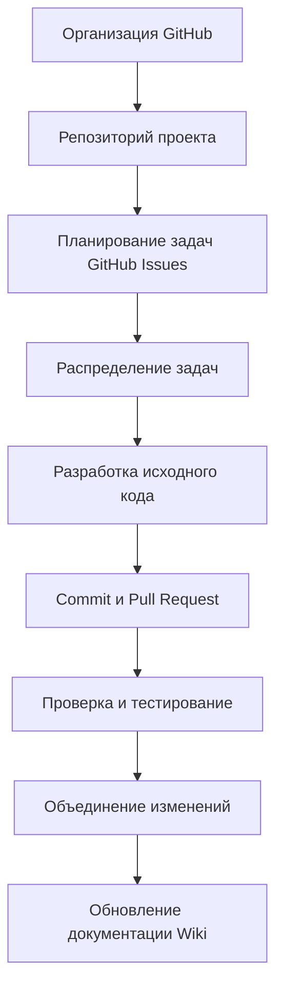

# Лабораторная работа №1

## Дисциплина
Программная инженерия

## Тема
Создание организации и проекта в GitHub

## Цель работы
Изучить основные возможности GitHub для организации
совместной разработки программного обеспечения.

## Описание проекта
Данный репозиторий создан в рамках лабораторной работы №1.

В ходе работы были выполнены следующие действия:

1. Создана учетная запись GitHub.
2. Создана организация GitHub.
3. Создан репозиторий проекта.
4. Настроен профиль пользователя.
5. Добавлены участники проекта.
6. Создана документация проекта.
7. Инициализирован репозиторий исходного кода.

## Используемые технологии

- Git
- GitHub
- Markdown

## Автор

Студент: Тхай Ван Кыонг

Группа: БФМО-02-26

## Схема совместной разработки проекта

Ниже представлена схема организации совместной
работы участников проекта с использованием GitHub.

Схема иллюстрирует основные этапы совместной
разработки программного обеспечения.
